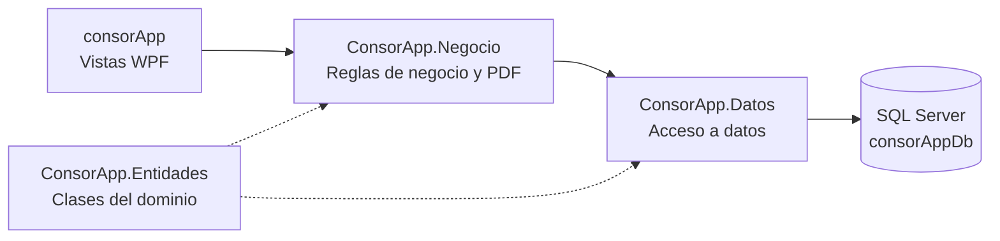

# 🏢 ConsorApp

Sistema de escritorio para la **administración de consorcio**: usuarios, departamentos, expensas, avisos, reservas de espacios comunes, reclamos, reportes y respaldos de la base de datos.


## 📋 Contenido

- [Funcionalidades](#-funcionalidades)
- [Perfiles y permisos](#-perfiles-y-permisos)
- [Tecnologías](#-tecnologías)
- [Arquitectura](#-arquitectura)
- [Instalación y puesta en marcha](#-instalación-y-puesta-en-marcha)
- [Usuarios de prueba](#-usuarios-de-prueba)
- [Reportes y estadísticas](#-reportes-y-estadísticas)
- [Respaldos de la base de datos](#-respaldos-de-la-base-de-datos)
- [Estructura del repositorio](#-estructura-del-repositorio)
- [Autores](#-autores)

---

## ✨ Funcionalidades

| Módulo | Qué permite |
|---|---|
| **Inicio de sesión** | Acceso con usuario y contraseña. El menú cambia según el perfil. |
| **Datos del edificio** | Nombre, ubicación, cantidad de pisos y de departamentos. |
| **Gestión de usuarios** | Alta, modificación, baja y reactivación. Filtros por estado y por perfil. |
| **Departamentos** | Alta de unidades y asignación de propietarios. |
| **Liquidación de expensas** | Carga de gastos por concepto, liquidación mensual (período `MM/aaaa`) dividida entre los departamentos con propietario vigente, registro de pagos y PDF de la liquidación. |
| **Avisos** | Publicación de avisos generales del edificio o dirigidos a un departamento. |
| **Reservas de espacios comunes** | Reservas por turno (Mañana, Tarde y Noche), bloqueos de espacios y control de reservas. |
| **Reclamos** | Carga de reclamos por los propietarios, con clasificación automática por categoría, y seguimiento de su estado. |
| **Reportes y estadísticas** | Morosidad, reclamos, uso de espacios y gastos por concepto, con gráficos y exportación a PDF. |
| **Respaldos** | Backup completo de la base, verificación del archivo y restauración protegida con contraseña. |

---

## 👥 Perfiles y permisos

| Opción del menú | Administrador | Encargado | Propietario |
|---|:---:|:---:|:---:|
| Mi departamento | | | ✅ |
| Avisos | ✅ | ✅ | ✅ |
| Reclamos (cargar los propios) | | | ✅ |
| Reservas (reservar un espacio) | | | ✅ |
| Datos del edificio | ✅ | | |
| Liquidación de expensas | ✅ | | |
| Gestión de usuarios | ✅ | | |
| Departamentos | ✅ | ✅ | |
| Control de reservas | ✅ | ✅ | |
| Control de reclamos | ✅ | ✅ | |
| Reportes y estadísticas | ✅ | | |
| Respaldos | ✅ | | |

---

## 🛠️ Tecnologías

- **C# / .NET 10** (`net10.0-windows`) con **WPF** (XAML + code-behind)
- **SQL Server Express** como base de datos, accedida con **ADO.NET** (`Microsoft.Data.SqlClient`). El proyecto también incluye un contexto de **Entity Framework Core** y su migración inicial.
- **QuestPDF** (licencia Community) para generar los PDF
- **LiveCharts.Wpf** para los gráficos de torta de la pantalla de reportes

---

## 🧱 Arquitectura

La solución está separada en 4 proyectos, con arquitectura en capas:



- **consorApp**: ventanas XAML, eventos y sesión del usuario. No tiene SQL.
- **ConsorApp.Negocio**: validaciones y reglas (liquidación, reservas, reclamos), generación de PDF y servicio de respaldos.
- **ConsorApp.Datos**: consultas y comandos SQL contra `consorAppDb`.
- **ConsorApp.Entidades**: clases del dominio (`Usuario`, `Departamento`, `Expensa`, `Reclamo`, etc.).

---

## 🚀 Instalación y puesta en marcha

### Requisitos

- Windows 10 u 11
- [.NET 10 SDK](https://dotnet.microsoft.com/download) (y Visual Studio compatible con .NET 10, si querés abrir la solución desde el IDE)
- SQL Server Express con una instancia llamada **`.\SQLEXPRESS`**
- SQL Server Management Studio (SSMS), para ejecutar el script

### Pasos

1. **Clonar el repositorio**

   ```bash
   git clone <URL-de-tu-repositorio>
   cd <carpeta-del-repositorio>
   ```

2. **Crear la base de datos.** Abrí SSMS, conectate a `.\SQLEXPRESS`, abrí el archivo [`ConsorApp.Datos/script_consorApp.sql`](ConsorApp.Datos/script_consorApp.sql) y ejecutalo **completo** (F5). El script crea la base `consorAppDb`, las 16 tablas, los perfiles, los turnos y los usuarios de prueba. Se puede volver a ejecutar sin duplicar datos.

3. **Abrir y ejecutar la aplicación**

   - Desde Visual Studio: abrí `consorApp/consorApp.slnx` y ejecutá el proyecto **consorApp**.
   - O desde la terminal:

     ```bash
     dotnet run --project consorApp/consorApp.csproj
     ```

4. **Iniciar sesión** con alguno de los [usuarios de prueba](#-usuarios-de-prueba).


## 🔑 Usuarios de prueba

El script de instalación crea tres usuarios.

| Usuario | Perfil |
|---|---|
| `admin` | Administrador |
| `encargado` | Encargado |
| `propietario` | Propietario |

> Son datos de prueba para desarrollo. Los datos personales de estos usuarios son de relleno y se pueden cambiar desde **Gestión de usuarios**.

---

## 📊 Reportes y estadísticas

Disponible para el **Administrador**. Se elige un rango de fechas y se actualizan:

- **5 indicadores:** unidades morosas, deuda total, reclamos pendientes, reservas del período y gastos.
- **4 pestañas**, cada una con su tabla y su gráfico:
  - Morosidad y deudas (por departamento)
  - Reclamos frecuentes (por categoría, con resueltos y pendientes)
  - Uso de espacios comunes (por espacio y por turno)
  - Gastos por concepto (con porcentaje y ranking)
- **Exportación a PDF** de la pestaña que esté abierta.

Cada reporte **agrupa y acumula** los datos con consultas SQL (`GROUP BY`, `SUM`, `COUNT`): devuelve una fila por grupo y no cada registro.

Flujo: `ReportesEstadisticasView` → `ReportesNegocio` → `ReportesDatos` (consultas SQL) → `ReportesPdfService` y `TortaRenderer` (PDF).

---

## 💾 Respaldos de la base de datos

El **Administrador** puede, desde el menú **Respaldos**:

- **Hacer un backup completo** de `consorAppDb`. Los archivos se guardan como `consorAppDb_aaaaMMdd_HHmmss_FULL.bak` en la carpeta configurada.
- **Probar un backup** (`RESTORE VERIFYONLY`) para comprobar que el archivo está íntegro.
- **Restaurar** un backup. Reemplaza todos los datos actuales y pide la contraseña del administrador (3 intentos).
- **Configurar** la carpeta de respaldos. La configuración se guarda en `%AppData%\ConsorApp\respaldos.json`.

> **Nota:** un `.bak` generado en otra computadora recuerda las rutas de los archivos de esa máquina. Si en la tuya esas carpetas no existen, el restore falla y hay que restaurarlo con `WITH MOVE` desde SSMS.

---

## 📁 Estructura del repositorio

```
├── consorApp/              # Proyecto WPF: vistas XAML, code-behind y consorApp.slnx
│   ├── Views/              # Ventanas de la aplicación
│   ├── Seguridad/          # Sesión del usuario (SesionUsuario)
│   └── Recursos/           # Ícono de la aplicación
├── ConsorApp.Negocio/      # Reglas de negocio, PDF (QuestPDF) y respaldos
├── ConsorApp.Datos/        # Acceso a datos, migraciones y script_consorApp.sql
└── ConsorApp.Entidades/    # Clases del dominio
```

---

## 👤 Autores

- **Integrantes:** Dorrego Octavio, Ferretti Sofia.
- **Materia / cátedra:** Taller de Programación II. 
- **Año:** 2026
